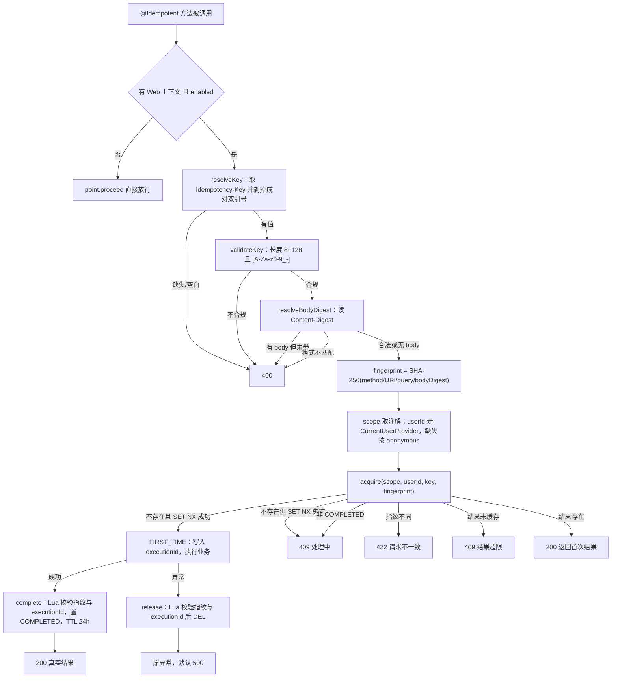

# 接口幂等（Idempotency-Key）

## 强制范围

`POST`/`PUT`/`PATCH` 三类业务写接口一律接入，不允许按“语义幂等”自行豁免；登录、登出、刷新令牌、验证码发送/校验、密码重置申请等认证类接口除外：

- 所有这三类业务映射方法（认证类除外）必须标注 `@Idempotent`，客户端必须携带 `Idempotency-Key` 请求头；带 body 时还必须携带 `Content-Digest`。
- **认证类 POST 不接入**：响应是短期凭证或一次性码，缓存 24h 会返回过期值；它们按 `security.md` 做限流、冷却与人机校验。
- `PUT` 在 HTTP 语义上幂等；`PATCH` 只有按幂等方式设计时才幂等，增量操作不幂等。即便语义幂等，也只保证“重复执行结果相同”，不保证副作用只发生一次；扣库存、发通知、记流水、调第三方都必须靠幂等键拦住重复执行。
- `GET`/`HEAD`/`OPTIONS` 天然幂等；`DELETE` 按资源 ID 重复执行结果一致，均不接入。
- 幂等不替代限流、防刷、防重放（见 `security.md`），也不替代数据库唯一约束。

**Redis 故障必须快速失败**：`acquire` 阶段连不上 Redis 时直接抛异常（走全局异常处理，默认 500），禁止捕获后放行业务。放行等于让重复请求直接写库，幂等形同虚设。

## 客户端契约

| 项 | 规则 |
| ---- | ---- |
| `Idempotency-Key` | 必填；同一业务操作的所有重试复用同一个值，新操作生成新值。建议直接用 UUID |
| 键格式 | 去首尾空白、剥掉一层成对双引号后，必须匹配 `^[A-Za-z0-9_-]{8,128}$`（长度上下限可配） |
| `Content-Digest` | 有 body 时必填，按 RFC 9530 写 `sha-256=:<base64>:`；无 body 可省略。只接受单条 `sha-256`，多算法摘要请客户端只发一条 |
| 重试 | 原样重发 method、URI、query（含顺序）与 body，摘要随之不变；method、URI、query 或摘要任一变化命中 422 |
| 收到 400 | key 缺失/超长/字符集非法，或有 body 未给摘要、摘要格式错；修正后重发 |
| 收到 409 | “处理中”稍后用同一 key 重试；“结果超限”改用查询接口确认，不能换 key 重发 |
| 收到 422 | 同 key 被不同请求指纹使用，属于客户端 bug，换新 key 即视为新操作 |

幂等键空间里的 `userId` 由服务端按项目实际鉴权方式确定（见「用户标识」），客户端不需要、也不应自报身份。

不要拿业务单号当 key：单号在首次重试时可能尚未生成，不同接口也可能复用同一单号。

`Content-Digest` 由客户端计算（RFC 9530，替代已废弃的 `Digest` 头），body 变化时必须按实际发送的新 body 重新计算。服务端不读请求体、无法校验它与 body 是否真的匹配——它只用于生成请求指纹，不是内容完整性校验，完整性要靠 HTTPS 与签名（见 `security.md`）。因此，**禁止复用旧摘要或手写常量摘要**；只改 body 而不更新摘要时，服务端无法识别变化，会按重放返回首次结果。

## 响应契约

| 场景 | Redis 状态 | 业务执行 | HTTP | 响应 |
| ---- | ---- | ---- | ---- | ---- |
| 首次 | 无记录，`SET NX` 成功 | 是 | 200 | 真实结果，完成后写缓存 |
| 并发抢占 | 无记录，`SET NX` 失败 | 否 | 409 | 处理中 |
| 处理中 | `INPROGRESS` | 否 | 409 | 处理中 |
| 脏数据 | 无法解析或状态非法 | 否 | 409 | 状态异常 |
| 指纹不符 | `COMPLETED` 且指纹不同 | 否 | 422 | key 已被不同请求使用 |
| 结果超限 | `COMPLETED` 且未缓存结果 | 否 | 409 | 走查询接口确认业务状态 |
| 重放 | `COMPLETED` 且指纹一致、结果存在 | 否 | 200 | 首次结果 |
| 参数不合规 | 未写入 | 否 | 400 | key 缺失/非法，或有 body 无摘要、摘要格式错 |
| 业务异常 | `INPROGRESS` 后 `DEL` | 是（失败） | 异常自带，默认 500 | 异常响应，同 key 可重试 |

**状态码口径**：缓存只保存 body，不保存状态码。首次与重放成功时统一 200，`POST` 不返回 201，`PUT`/`PATCH` 不返回 204。原因是重放必须能原样还原首次响应，而 201/204 无法从缓存结果推导。接口文档按 200 写。

由此带出三条硬约束：

1. 幂等接口的成功返回值禁止用 `ResponseEntity`，禁止用 `@ResponseStatus` 改成功状态码；
2. 禁止 `Callable`、`DeferredResult`、`WebAsyncTask`、SSE 等异步返回：切面拿到的是异步句柄，不是响应体；
3. 禁止直接写 `HttpServletResponse`：切面无法序列化并缓存结果。

业务失败必须抛异常，不能返回 `Result.fail(...)` 当正常返回。切面只把“没有抛异常”当成功，失败响应会被缓存 24 小时，同 key 再也无法重试。业务异常还必须保证自身事务回滚；短信、第三方扣款等跨系统副作用需要业务侧幂等，释放键后重试可能再次触发。

## 组件与调用链

| 组件 | 类型 | 职责 |
| ---- | ---- | ---- |
| `@Idempotent` | 方法注解 | 标记接入幂等，声明 scope 与应急开关 |
| `IdempotencyKeyAspect` | `@Aspect` | 校验 key 与摘要、算指纹、决定放行/回放/拒绝 |
| `CurrentUserProvider` | 接口 + 项目实现 | 从项目现有登录态取稳定的 `userId` |
| `IdempotencyProperties` | `@ConfigurationProperties` | key 长度、两个 TTL、结果大小上限 |
| `IdempotencyKeyService` | 接口 + 实现 | Redisson 状态读写，Lua 原子完成 |
| `IdempotencyException` | `RuntimeException` | 携带 400/409/422 状态码 |

**本方案没有 Filter，幂等链路不解包请求体**：body 的摘要由客户端通过 `Content-Digest` 提供，`@RequestBody` 仍由 MVC 正常解析，只是切面不碰它。好处是不存在请求体被提前读走导致 `@RequestBody` 为空、也不存在把大 body 全量读进内存的问题，过滤器顺序也不再需要协调；代价是摘要只能信任客户端声明，且客户端必须自行计算（见上文）。



切面只包 Controller 方法，事务边界仍在 Service：`point.proceed()` 内部完成事务提交后，切面才写 `COMPLETED`。禁止把 `@Transactional` 加到 Controller 上，否则提交顺序不再可控。

## 请求指纹

```text
SHA-256( method + 0x00 + requestURI + 0x00 + queryString + 0x00 + bodyDigest + 0x00 )
```

- 输出 64 位小写 hex。
- `queryString` 为 `null` 时按空串；保留原始顺序，不做参数重排。
- `bodyDigest` 取 `Content-Digest` 里 `sha-256=:` 与结尾 `:` 之间的 base64 原文；无 body 或未带摘要时为空串。
- 分隔符用 `0x00` 而非 `\n`：URI、query、header 值里都不可能出现 NUL，`ab`+`c` 与 `a`+`bc` 的拼接歧义被彻底堵死。
- 指纹只回答“是不是同一个请求”，不是签名：不含用户身份与时间戳。用户隔离由 key 空间里的 `userId` 完成，重放窗口由 TTL 完成。
- 指纹不含 `Content-Type`、`Content-Length`：同 body 换 `Content-Type` 会被当成同一请求，这是有意的，避免客户端无意义地改头导致 422。

## Redis 数据模型

```text
key        idempotent:key:{scope}:{userId}:{key}
INPROGRESS {"status":"INPROGRESS","fingerprint":"<64 位 hex>","executionId":"<UUID>"}
COMPLETED  {"status":"COMPLETED","fingerprint":"<64 位 hex>","executionId":"<UUID>","result":"<首次响应 JSON 字符串>"}
TTL        INPROGRESS 30s；COMPLETED 24h（均可配）
```

- `executionId` 是每次成功抢占时生成的执行所有权标识，与 fingerprint 一起写入记录；`complete`/`release` 必须同时匹配二者。fingerprint 只识别请求内容，不能区分超时前后的两次执行。
- 状态与结果放在同一个 string key 里，才能在 Lua 中原子完成“校验指纹与 executionId → 改状态 → 续 TTL”。拆成两个 key 会出现改了一半的中间态。
- `result` 缺失或为 `null` 表示首次结果没有缓存（超过上限或序列化失败），重放只能返回 409，让客户端走查询接口。
- 读写统一用 Redisson 的 `StringCodec`。默认 codec 会写出带类型信息的二进制格式，Lua 里的 `cjson.decode` 直接失败。
- 业务耗时必须小于 30s。超过后键提前过期，同 key 重试会再次执行业务；`executionId` 只能阻止旧请求误删或覆盖新记录，不能阻止超时后的重复执行。导入、对账、批量等长任务不适用本方案，应改异步任务 + 业务唯一键。
- 24h 是重放窗口。跨窗口重试会重新执行，关键写操作仍需数据库唯一约束兜底。

依赖 `redisson-spring-boot-starter`（Boot 2.x / 3.x 坐标相同，版本必须显式声明，Boot BOM 不管理它）：

```xml
<dependency>
    <groupId>org.redisson</groupId>
    <artifactId>redisson-spring-boot-starter</artifactId>
    <version>3.x.y</version>
</dependency>
```

`3.x.y` 换成项目实际使用的稳定版号，不要留空、不要指望 Boot BOM 管理。starter 自带的 `redisson-spring-data-*` 模块号按 Boot 次版本对齐（Boot 2.7 用 `redisson-spring-data-27`，Boot 3.2 用 `redisson-spring-data-32`）；档位不匹配时表现为 `RedisConnectionFactory` 类找不到或 `RedisTemplate` 报错，排除内置模块并显式声明对应模块即可。连接参数 Boot 3.x 写 `spring.data.redis.*`，Boot 2.x 写 `spring.redis.*`。本方案只用 `RedissonClient` 的 `RBucket`/`RScript`，不走 `RedisTemplate`。

多副本部署必须连同一个 Redis，不能用本地缓存。Redis 必须部署在内网并配置访问控制：缓存体是完整响应，可能包含手机号等个人信息，不能暴露到公网。

## 配置

```yaml
idempotent:
  min-key-length: 8
  max-key-length: 128
  in-progress-ttl: 30s
  completed-ttl: 24h
  max-result-bytes: 65536
```

```java
@Getter
@Setter
@Component
@ConfigurationProperties(prefix = "idempotent")
public class IdempotencyProperties {

    /** key 最小长度 */
    private int minKeyLength = 8;

    /** key 最大长度 */
    private int maxKeyLength = 128;

    /** INPROGRESS 存活时间，必须大于业务最长耗时 */
    private Duration inProgressTtl = Duration.ofSeconds(30);

    /** COMPLETED 保留时间，即重放窗口 */
    private Duration completedTtl = Duration.ofHours(24);

    /** 可缓存结果的上限（字节），超出时不缓存结果 */
    private int maxResultBytes = 64 * 1024;
}
```

## 实现

### 注解

```java
@Documented
@Target(ElementType.METHOD)
@Retention(RetentionPolicy.RUNTIME)
public @interface Idempotent {

    /** 幂等作用域，默认「类名.方法名」 */
    String scope() default "";

    /** 应急豁免，常规写接口不得关闭 */
    boolean enabled() default true;
}
```

只标 Controller 映射方法，不标 Service：切面依赖 Web 请求与声明返回类型，标在 Service 上会被内部调用误拦。

### 用户标识（按项目实际鉴权实现）

幂等键的隔离维度是「接口 + 用户 + key」，`userId` 必须来自项目已有的登录态，不为幂等单独造一套身份约定。动手前先看项目现在用的是什么：

| 项目鉴权方式 | 取 userId 的方式 |
| ---- | ---- |
| Spring Security | `SecurityContextHolder.getContext().getAuthentication()`，从 principal 取不可变用户 ID；没有自定义 principal 时用 `authentication.getName()` |
| Sa-Token | `StpUtil.getLoginIdAsString()` |
| 自定义 `UserContext` / ThreadLocal | 调用项目现有工具，如 `UserContext.getUserId()` |
| 网关透传 | 只读取网关注入、且入口已剥离客户端同名头的标识；优先在鉴权过滤器里写入上下文，切面不直接读 header |
| 无登录态 | 仅允许匿名访问的接口用 `anonymous`；需要登录的接口由鉴权层在进入 Controller 前返回 401 |

统一封装成下面的接口，切面只依赖它；换鉴权方式时只改实现。一个项目只保留一个实现，多套鉴权并存时用 `@Primary` 指定当前生效的那个：

```java
public interface CurrentUserProvider {

    /** 返回当前登录用户的稳定 ID；未登录返回 null */
    String getUserId();
}
```

Spring Security 项目的默认实现（`LoginUser` 换成项目实际的 principal 类型；没有自定义 principal 时直接用 `authentication.getName()`，但要确认它是稳定唯一 ID，不是可改的昵称）：

```java
@Component
public class SecurityCurrentUserProvider implements CurrentUserProvider {

    @Override
    public String getUserId() {
        Authentication authentication = SecurityContextHolder.getContext().getAuthentication();
        if (authentication == null || !authentication.isAuthenticated()
                || authentication instanceof AnonymousAuthenticationToken) {
            return null;
        }
        Object principal = authentication.getPrincipal();
        if (principal instanceof LoginUser) {
            return String.valueOf(((LoginUser) principal).getId());
        }
        return authentication.getName();
    }
}
```

网关透传的项目，在鉴权过滤器里把网关注入的标识写入 `UserContext`，再由 `CurrentUserProvider` 读上下文；切面不直接读请求头，避免入口漏剥离时把客户端自报身份当成登录态。切面取不到 `userId` 时落到 `anonymous`，是否需要登录由接口自身的鉴权规则决定——需要登录的接口在进入 Controller 前就应被拒绝，不会走到切面。

### 切面

切面依赖 `spring-boot-starter-aop`（提供 aspectjweaver）；只加 `spring-boot-starter-web` 时 `@Aspect` 不会被启用，表现为“注解在、幂等不生效”。

```java
@Slf4j
@Aspect
@Component
@RequiredArgsConstructor
public class IdempotencyKeyAspect {

    private static final String HEADER_KEY = "Idempotency-Key";
    private static final String HEADER_CONTENT_DIGEST = "Content-Digest";
    private static final Pattern KEY_CHARSET = Pattern.compile("^[A-Za-z0-9_-]+$");
    private static final Pattern CONTENT_DIGEST = Pattern.compile("^sha-256=:([A-Za-z0-9+/]{43}=):$");

    private final IdempotencyKeyService idempotencyKeyService;
    private final CurrentUserProvider currentUserProvider;
    private final IdempotencyProperties properties;
    private final ObjectMapper objectMapper;

    @Around("@annotation(idempotent)")
    public Object around(ProceedingJoinPoint point, Idempotent idempotent) throws Throwable {
        RequestAttributes attributes = RequestContextHolder.getRequestAttributes();
        if (!(attributes instanceof ServletRequestAttributes) || !idempotent.enabled()) {
            return point.proceed();
        }

        HttpServletRequest request = ((ServletRequestAttributes) attributes).getRequest();
        String key = validateKey(resolveKey(request));
        String bodyDigest = resolveBodyDigest(request);
        String fingerprint = fingerprint(request, bodyDigest);

        Method method = ((MethodSignature) point.getSignature()).getMethod();
        String scope = idempotent.scope().isEmpty()
                ? method.getDeclaringClass().getSimpleName() + "." + method.getName()
                : idempotent.scope();
        String userId = currentUserProvider.getUserId();
        if (userId == null || userId.isEmpty()) {
            userId = "anonymous";
        }

        IdempotencyResult result = idempotencyKeyService.acquire(scope, userId, key, fingerprint);
        switch (result.getState()) {
            case CONFLICT:
                throw new IdempotencyException(HttpStatus.CONFLICT,
                        "相同请求正在处理中，请稍后用同一 Idempotency-Key 重试");
            case PAYLOAD_MISMATCH:
                throw new IdempotencyException(HttpStatus.UNPROCESSABLE_ENTITY,
                        "该 Idempotency-Key 已被不同请求使用");
            case RESULT_TOO_LARGE:
                throw new IdempotencyException(HttpStatus.CONFLICT,
                        "首次结果未缓存，请通过查询接口确认业务状态");
            case DUPLICATE:
                return deserialize(result.getResultJson(), method);
            case FIRST_TIME:
            default:
                break;
        }

        String executionId = result.getExecutionId();
        Object value;
        try {
            value = point.proceed();
        } catch (Throwable ex) {
            releaseQuietly(scope, userId, key, fingerprint, executionId);
            throw ex;
        }
        completeQuietly(scope, userId, key, fingerprint, executionId, value);
        return value;
    }
```

私有方法如下：

```java
    private String resolveKey(HttpServletRequest request) {
        String raw = request.getHeader(HEADER_KEY);
        if (raw == null || raw.trim().isEmpty()) {
            throw new IdempotencyException(HttpStatus.BAD_REQUEST, "缺少 Idempotency-Key 请求头");
        }
        String key = raw.trim();
        if (key.length() >= 2 && key.startsWith("\"") && key.endsWith("\"")) {
            key = key.substring(1, key.length() - 1);
        }
        return key;
    }

    private String validateKey(String key) {
        int min = properties.getMinKeyLength();
        int max = properties.getMaxKeyLength();
        if (key.length() < min || key.length() > max || !KEY_CHARSET.matcher(key).matches()) {
            throw new IdempotencyException(HttpStatus.BAD_REQUEST,
                    "Idempotency-Key 需为 " + min + "~" + max + " 位 [A-Za-z0-9_-]");
        }
        return key;
    }

    private String resolveBodyDigest(HttpServletRequest request) {
        String raw = request.getHeader(HEADER_CONTENT_DIGEST);
        if (raw == null || raw.trim().isEmpty()) {
            if (mayHaveBody(request)) {
                throw new IdempotencyException(HttpStatus.BAD_REQUEST,
                        "请求带有 body，必须提供 Content-Digest（sha-256=:<base64>:）");
            }
            return "";
        }
        Matcher matcher = CONTENT_DIGEST.matcher(raw.trim());
        if (!matcher.matches()) {
            throw new IdempotencyException(HttpStatus.BAD_REQUEST,
                    "Content-Digest 格式非法，要求 sha-256=:<base64>:");
        }
        return matcher.group(1);
    }

    private boolean mayHaveBody(HttpServletRequest request) {
        long length = request.getContentLengthLong();
        if (length > 0 || request.getHeader("Transfer-Encoding") != null) {
            return true;
        }
        String protocol = request.getProtocol();
        return length < 0 && protocol != null && protocol.startsWith("HTTP/2");
    }

    private String fingerprint(HttpServletRequest request, String bodyDigest) {
        try {
            MessageDigest digest = MessageDigest.getInstance("SHA-256");
            updateDigest(digest, request.getMethod());
            updateDigest(digest, request.getRequestURI());
            updateDigest(digest, request.getQueryString());
            updateDigest(digest, bodyDigest);
            return toHex(digest.digest());
        } catch (NoSuchAlgorithmException e) {
            throw new IllegalStateException("JVM 不支持 SHA-256", e);
        }
    }

    private void updateDigest(MessageDigest digest, String value) {
        if (value != null) {
            digest.update(value.getBytes(StandardCharsets.UTF_8));
        }
        digest.update((byte) 0x00);
    }

    private String toHex(byte[] bytes) {
        StringBuilder hex = new StringBuilder(bytes.length * 2);
        for (byte b : bytes) {
            hex.append(Character.forDigit((b >> 4) & 0xF, 16))
                    .append(Character.forDigit(b & 0xF, 16));
        }
        return hex.toString();
    }

    private Object deserialize(String json, Method method) {
        if (method.getReturnType() == void.class || method.getReturnType() == Void.class) {
            return null;
        }
        try {
            JavaType type = objectMapper.getTypeFactory().constructType(method.getGenericReturnType());
            return objectMapper.readValue(json, type);
        } catch (JsonProcessingException e) {
            log.error("幂等缓存反序列化失败，拒绝执行业务，type={}", method.getGenericReturnType(), e);
            throw new IdempotencyException(HttpStatus.INTERNAL_SERVER_ERROR,
                    "缓存结果无法还原，请通过查询接口确认业务状态");
        }
    }

    private void completeQuietly(String scope, String userId, String key,
                                 String fingerprint, String executionId, Object value) {
        String resultJson;
        try {
            resultJson = objectMapper.writeValueAsString(value);
        } catch (JsonProcessingException e) {
            log.warn("幂等结果序列化失败，按未缓存处理 scope={} key={}", scope, key, e);
            resultJson = null;
        }
        try {
            idempotencyKeyService.complete(scope, userId, key, fingerprint, executionId, resultJson);
        } catch (Exception e) {
            log.warn("幂等完成标记写入失败，键将在处理中 TTL 到期后失效 scope={} key={}", scope, key, e);
        }
    }

    private void releaseQuietly(String scope, String userId, String key,
                                String fingerprint, String executionId) {
        try {
            idempotencyKeyService.release(scope, userId, key, fingerprint, executionId);
        } catch (Exception e) {
            log.warn("幂等键释放失败，键将在处理中 TTL 到期后失效 scope={} key={}", scope, key, e);
        }
    }
}
```

`complete` 阶段无论序列化还是 Redis 写入失败，都只记 warn，不释放键、不回滚业务：业务已经成功，释放键会让重试再执行一次。这是本方案最重要的失败边界。

`deserialize` 用 `getGenericReturnType()` 而不是裸 `Class`：接口返回 `Result<OrderVO>` 时，只有泛型类型才能把 VO 还原成真实类型，否则重放结果会变成 `LinkedHashMap`。

### Redis 服务

```java
public enum IdempotencyState {
    FIRST_TIME, DUPLICATE, CONFLICT, PAYLOAD_MISMATCH, RESULT_TOO_LARGE
}
```

```java
@Getter
@RequiredArgsConstructor
public class IdempotencyResult {

    private final IdempotencyState state;
    private final String resultJson;
    private final String executionId;

    public static IdempotencyResult firstTime(String executionId) {
        return new IdempotencyResult(IdempotencyState.FIRST_TIME, null, executionId);
    }

    public static IdempotencyResult duplicate(String resultJson) {
        return new IdempotencyResult(IdempotencyState.DUPLICATE, resultJson, null);
    }

    public static IdempotencyResult conflict() {
        return new IdempotencyResult(IdempotencyState.CONFLICT, null, null);
    }

    public static IdempotencyResult payloadMismatch() {
        return new IdempotencyResult(IdempotencyState.PAYLOAD_MISMATCH, null, null);
    }

    public static IdempotencyResult resultTooLarge() {
        return new IdempotencyResult(IdempotencyState.RESULT_TOO_LARGE, null, null);
    }
}
```

```java
public interface IdempotencyKeyService {

    IdempotencyResult acquire(String scope, String userId, String key, String fingerprint);

    void complete(String scope, String userId, String key,
                  String fingerprint, String executionId, String resultJson);

    void release(String scope, String userId, String key, String fingerprint, String executionId);
}
```

```java
@Slf4j
@Service
@RequiredArgsConstructor
public class IdempotencyKeyServiceImpl implements IdempotencyKeyService {

    private static final String KEY_PREFIX = "idempotent:key:";
    private static final String IN_PROGRESS = "INPROGRESS";
    private static final String COMPLETED = "COMPLETED";

    private static final String COMPLETE_LUA =
            "local v = redis.call('GET', KEYS[1]) "
                    + "if not v then return 0 end "
                    + "local ok, o = pcall(cjson.decode, v) "
                    + "if not ok or type(o) ~= 'table' or o.status ~= 'INPROGRESS' then return 0 end "
                    + "if o.fingerprint ~= ARGV[1] or o.executionId ~= ARGV[2] then return -1 end "
                    + "o.status = 'COMPLETED' "
                    + "if ARGV[3] ~= '' then o.result = ARGV[3] end "
                    + "redis.call('SET', KEYS[1], cjson.encode(o), 'PX', ARGV[4]) "
                    + "return 1";

    private static final String RELEASE_LUA =
            "local v = redis.call('GET', KEYS[1]) "
                    + "if not v then return 0 end "
                    + "local ok, o = pcall(cjson.decode, v) "
                    + "if not ok or type(o) ~= 'table' or o.status ~= 'INPROGRESS' then return 0 end "
                    + "if o.fingerprint ~= ARGV[1] or o.executionId ~= ARGV[2] then return -1 end "
                    + "redis.call('DEL', KEYS[1]) "
                    + "return 1";

    private final RedissonClient redissonClient;
    private final ObjectMapper objectMapper;
    private final IdempotencyProperties properties;

    @Override
    public IdempotencyResult acquire(String scope, String userId, String key, String fingerprint) {
        RBucket<String> bucket = bucket(scope, userId, key);
        String current = bucket.get();
        if (current == null) {
            KeyRecord record = new KeyRecord();
            record.setStatus(IN_PROGRESS);
            record.setFingerprint(fingerprint);
            record.setExecutionId(UUID.randomUUID().toString());
            boolean created = bucket.trySet(toJson(record),
                    properties.getInProgressTtl().toMillis(), TimeUnit.MILLISECONDS);
            return created
                    ? IdempotencyResult.firstTime(record.getExecutionId())
                    : IdempotencyResult.conflict();
        }
        KeyRecord record = fromJson(current);
        if (record == null || !COMPLETED.equals(record.getStatus())) {
            return IdempotencyResult.conflict();
        }
        if (!fingerprint.equals(record.getFingerprint())) {
            return IdempotencyResult.payloadMismatch();
        }
        if (record.getResult() == null || record.getResult().isEmpty()) {
            return IdempotencyResult.resultTooLarge();
        }
        return IdempotencyResult.duplicate(record.getResult());
    }

    @Override
    public void complete(String scope, String userId, String key,
                         String fingerprint, String executionId, String resultJson) {
        Long code = eval(COMPLETE_LUA, scope, userId, key, fingerprint, executionId,
                withinLimit(resultJson) ? resultJson : "",
                String.valueOf(properties.getCompletedTtl().toMillis()));
        if (!Long.valueOf(1L).equals(code)) {
            log.warn("幂等完成标记未生效 code={} scope={} key={}", code, scope, key);
        }
    }

    @Override
    public void release(String scope, String userId, String key,
                        String fingerprint, String executionId) {
        Long code = eval(RELEASE_LUA, scope, userId, key, fingerprint, executionId);
        if (!Long.valueOf(1L).equals(code)) {
            log.warn("幂等键未释放 code={} scope={} key={}，键将在处理中 TTL 到期后失效",
                    code, scope, key);
        }
    }

    private Long eval(String lua, String scope, String userId, String key, Object... args) {
        return redissonClient.getScript(StringCodec.INSTANCE)
                .eval(RScript.Mode.READ_WRITE, lua, RScript.ReturnType.INTEGER,
                        Collections.singletonList(redisKey(scope, userId, key)), args);
    }

    private boolean withinLimit(String resultJson) {
        return resultJson != null
                && resultJson.getBytes(StandardCharsets.UTF_8).length <= properties.getMaxResultBytes();
    }

    private RBucket<String> bucket(String scope, String userId, String key) {
        return redissonClient.getBucket(redisKey(scope, userId, key), StringCodec.INSTANCE);
    }

    private String redisKey(String scope, String userId, String key) {
        return KEY_PREFIX + scope + ":" + userId + ":" + key;
    }

    private String toJson(KeyRecord record) {
        try {
            return objectMapper.writeValueAsString(record);
        } catch (JsonProcessingException e) {
            throw new IllegalStateException("幂等记录序列化失败", e);
        }
    }

    private KeyRecord fromJson(String json) {
        try {
            return objectMapper.readValue(json, KeyRecord.class);
        } catch (JsonProcessingException e) {
            log.warn("幂等记录解析失败，按脏数据处理", e);
            return null;
        }
    }

    @Data
    private static class KeyRecord {
        private String status;
        private String fingerprint;
        private String executionId;
        private String result;
    }
}
```

两个脚本的返回码一致：`1` 执行成功；`0` 记录不存在、无法解析或已不是 `INPROGRESS`；`-1` 指纹或 `executionId` 不符。非 `1` 只记 warn，不影响客户端拿到的响应：`complete` 失败时业务已成功，客户端仍收到 200；`release` 抛异常时键可能残留为 `INPROGRESS`，同 key 重试拿到 409，处理中 TTL 到期后才可重试。

`COMPLETE_LUA` 的 `ARGV[3]` 传空串表示“结果未缓存”，脚本不会写入 `result` 字段，重放时命中 `RESULT_TOO_LARGE`。结果大小判断放在 Service 而不是切面，是为了让“超限按未缓存处理”和写入状态在同一处收口。

Redis 故障不吞异常：`acquire` 直接抛出，由全局异常处理转 500；`complete` / `release` 的异常由切面兜住并记 warn。

### 异常与全局处理

```java
@Getter
public class IdempotencyException extends RuntimeException {

    private final HttpStatus status;

    public IdempotencyException(HttpStatus status, String message) {
        super(message);
        this.status = status;
    }
}
```

```java
@ExceptionHandler(IdempotencyException.class)
public ResponseEntity<Result<Void>> handleIdempotencyException(IdempotencyException e) {
    return ResponseEntity.status(e.getStatus())
            .body(Result.fail(e.getStatus().value(), e.getMessage()));
}
```

`Result` 按项目统一响应体替换。关键是 HTTP 状态码必须真实输出 400/409/422，不能一律 200；网关和客户端重试策略依赖状态码判断。

### Controller 与接口文档

```java
@Operation(summary = "创建订单")
@ApiResponse(responseCode = "200", description = "创建成功；同 key 重放返回首次结果")
@Idempotent
@PostMapping("/orders")
public Result<OrderVO> create(
        @Parameter(description = "幂等键，8~128 位 [A-Za-z0-9_-]，同一操作重试必须复用", required = true)
        @RequestHeader(value = "Idempotency-Key", required = false) String idempotencyKey,
        @Parameter(description = "请求体摘要，sha-256=:<base64>:，由客户端计算", required = true)
        @RequestHeader(value = "Content-Digest", required = false) String contentDigest,
        @RequestBody @Valid CreateOrderDTO dto) {
    return Result.ok(orderService.create(dto));
}
```

两个 `@RequestHeader` 都用 `required = false`，让切面统一做 400 校验与错误文案；`@Parameter(required = true)` 保证文档显示必填。参数本身可以不在业务里使用，切面直接读 request。

## 验收用例

| 用例 | 操作 | 期望 |
| ---- | ---- | ---- |
| 首次 | 新 key、正确摘要提交 | 200，业务执行一次，Redis 记录转为 `COMPLETED` |
| 重放 | 同 key、同 method/URI/query/body/摘要 | 200，返回首次结果，业务不执行 |
| 改体 | 同 key，改 body 并同步改摘要 | 422 |
| 改 query | 同 key 同 body，query 顺序变化 | 422 |
| 并发 | 两个线程同 key 同 body 同时提交 | 一个 200，一个 409；首个完成得快则后者 200 重放 |
| 业务异常 | 业务抛异常 | 异常自带状态码，key 已删除；同 key 重试可成功 |
| 处理中过期 | A 的 `INPROGRESS` 过期后 B 获取同 key，再触发 A 的 `complete`/`release` | A 的操作因 `executionId` 不符而不生效，B 的记录不被删除或覆盖 |
| 缺 key | 不带头或只有空白 | 400，业务不执行 |
| key 超长 | 129 位 | 400，业务不执行 |
| 缺摘要 | 有 body 但不带 `Content-Digest` | 400，业务不执行 |
| 摘要非法 | 非 `sha-256=:<base64>:` 格式 | 400，业务不执行 |
| 大结果 | 首次响应 > 64KB | 首次 200；同 key 重放 409 |
| 非幂等方法 | GET/DELETE、认证类 POST 不带头 | 正常执行，不受影响 |
| Redis 故障 | 停掉 Redis 后提交 | 500，业务不执行 |

手工验证可重复执行同一条命令，观察订单只落一条：

```bash
TOKEN="从项目登录接口获取的 access token"
KEY="manual-$(date +%s)"
BODY='{"skuId":1,"count":1}'
DIGEST="sha-256=:$(printf '%s' "$BODY" | openssl dgst -sha256 -binary | openssl base64 -A):"
for i in 1 2; do
  curl -s -o /dev/null -w "%{http_code}\n" -X POST "http://localhost:8080/orders" \
    -H "Content-Type: application/json" \
    -H "Idempotency-Key: $KEY" \
    -H "Content-Digest: $DIGEST" \
    -H "Authorization: Bearer $TOKEN" \
    --data-binary "$BODY"
done
```

鉴权头按项目实际方式替换，上面只是 Bearer token 示例。`--data-binary` 保证发出去的字节与算摘要的字节完全一致；`-d` 会剥离换行，body 一旦多行摘要就对不上。

## 已知边界与兜底

1. **摘要不可校验**：服务端不读 body，`Content-Digest` 是客户端自报。客户端算错、复用旧摘要，会让“不同 body 同 key”被误判成重放并返回旧结果。用标准 HTTP 客户端按实际 body 计算，禁止手写常量摘要。
2. **30s 处理窗口**：业务耗时超过 `inProgressTtl`，键会提前过期，同 key 重试会再次执行。`executionId` 能阻止旧请求释放或覆盖新记录，但不能消除超时导致的重复执行；关键写操作仍需数据库唯一约束或状态机兜底。长任务改异步 + 业务唯一键，不要拉长 TTL 硬扛。
3. **24h 重放窗口**：超过 `completedTtl` 的同 key 请求按新请求执行。客户端重试窗口必须小于 24h。
4. **提交后崩溃**：业务事务已提交、`complete` 尚未执行时进程崩溃，键会在 30s 后过期，重试会再执行一次。Redis 与数据库之间没有分布式事务，订单、支付等关键写操作必须再加数据库唯一约束或状态机兜底。
5. **Redis 主从切换**：异步复制可能丢掉最后写入的 `COMPLETED` 记录，极端情况下重试会再次执行。幂等 Redis 必须与业务库同机房部署，关键接口不能只依赖这一层。
6. **结果超限**：响应 JSON 超过 `maxResultBytes` 或序列化失败时不缓存，重放只能返回 409。需要重放大结果的接口应改为“提交任务 + 查询结果”两段式。
7. **用户标识来源**：`userId` 从项目现有登录态取（Spring Security 的 principal、Sa-Token 的 `StpUtil`、自定义 `UserContext`），统一走 `CurrentUserProvider`。网关透传部署只信任网关注入、且入口已剥离客户端同名头的标识，并先写进登录上下文再供切面读取；直接读客户端自报的 header 会让攻击者命中他人缓存结果。公开接口用 `anonymous`，且不得返回敏感数据。
8. **HTTP/2 长度判断**：`mayHaveBody` 里 `CL < 0 且 HTTP/2` 依赖容器的 `getProtocol()`，部分容器对 HTTP/2 仍报 `HTTP/1.1`，这一条只是兜底。客户端必须始终发送 `Content-Length` 或 `Content-Digest`。
9. **文件上传**：multipart 也能算摘要，但大文件摘要计算成本高、客户端实现容易出错；上传去重仍应使用文件哈希或业务单号，不依赖本方案。
10. **响应后处理**：`ResponseBodyAdvice` 必须是确定性的。若它给每次响应注入时间戳、随机串，重放结果会与首次不一致。
11. **scope 冲突**：默认 scope 用简单类名，不同包下同名 Controller 必须显式指定 `@Idempotent(scope = "...")`，否则键空间串用。
12. **权限变更**：重放直接返回缓存，不再执行资源归属校验；鉴权仍在 Controller 之前完成，但权限被回收后 24h 内仍可能读到旧结果。敏感资源应缩短结果 TTL，或在重放前复核权限。

## 不做的事

- 不因 `PUT`/`PATCH` 语义幂等就省掉 `Idempotency-Key`。
- 不加 Filter、不在服务端读请求体算摘要：摘要由客户端给，服务端只做格式校验。
- 不用 `Digest` 头（已废弃），统一 `Content-Digest`。
- 不用 Java 原生序列化缓存结果：JSON 可读、跨版本、能直接回写响应。
- 不为单个接口增加 TTL、结果大小等参数：统一走 `IdempotencyProperties`，确有差异时拆独立接口。`enabled` 只作应急豁免，不参与常规配置。
- 不在 Redis 故障时降级放行。
- 不把幂等键当业务唯一键：它只保证“同一次操作不重复执行”，不保证业务实体唯一，数据库唯一索引仍要保留。
